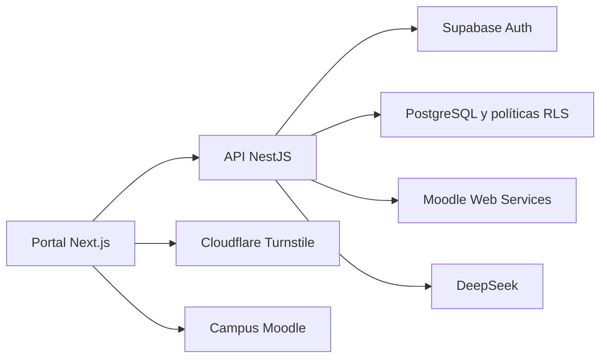

# Programación literaria de IINICIA Portal

IINICIA Portal publica la oferta académica y acompaña a una persona desde el registro hasta la admisión, la matrícula y el acceso al campus. El personal consulta o modifica esos datos según su rol, sus permisos y los programas que tiene asignados.

## Arquitectura y orden de lectura

| Paso | Archivos de entrada | Qué explica cada parte |
| --- | --- | --- |
| 1. Arranque | [API](apps/api/src/main.ts) · [Módulos NestJS](apps/api/src/app.module.ts) · [Composición del portal](apps/web/src/app/layout.tsx) | Express recibe las solicitudes de la API. Next.js monta el tema, la sesión y los componentes comunes del navegador. |
| 2. Identidad | [Sesión del navegador](apps/web/src/contexts/AuthContext.tsx) · [Rutas de autenticación](apps/api/src/modules/auth/auth.controller.ts) · [Cliente Supabase](apps/api/src/common/supabase/supabase.service.ts) | Une el formulario con el proveedor de identidad y con el perfil del portal. |
| 3. Acceso | [Sesión](apps/api/src/common/auth/supabase-auth.guard.ts) · [Roles](apps/api/src/common/auth/roles.guard.ts) · [Permisos](apps/api/src/common/auth/permissions.guard.ts) · [Ámbito](apps/api/src/common/auth/program-scope.ts) | La API identifica al titular, comprueba el segundo factor y evalúa qué operación puede realizar y sobre qué programas. |
| 4. Ciclo académico | [Admisiones](apps/api/src/modules/admissions/admissions.service.ts) · [Matrículas](apps/api/src/modules/enrollments/enrollments.service.ts) · [Coordinación y soporte](apps/web/src/components/RoleWorkspace.tsx) | Separa la decisión académica de la sincronización de la matrícula con el campus. |
| 5. Datos e integraciones | [Migraciones](supabase/migrations) · [Moodle](apps/api/src/modules/moodle/moodle.service.ts) · [Chat](apps/api/src/modules/help-chat/help-chat.service.ts) | PostgreSQL conserva las relaciones y políticas. Los clientes externos aíslan el transporte y traducen sus respuestas. |
| 6. Verificación | [Pruebas HTTP](apps/api/test/lifecycle.e2e-spec.ts) · [Prueba de navegación Moodle](apps/web/test/moodle-window.test.mjs) · [Pruebas de privilegios](supabase/tests/client_privileges.sql) | Muestra qué se comprueba con dependencias simuladas y qué requiere una base de ensayo. |

El portal usa React, Next.js, TypeScript y Tailwind CSS. La API usa NestJS con Express, validación de DTO y una especificación [OpenAPI](docs/openapi.yaml). Supabase proporciona Auth y acceso a PostgreSQL. [Docker Compose](docker/compose.yaml) reúne los procesos del entorno local. El tema de Moodle conserva sus reglas aparte en [moodle-theme.scss](docs/moodle-theme.scss).

## Registro, sesión y recuperación

1. El [registro](apps/web/src/app/registro/page.tsx) entrega la cuenta y los datos del perfil a la API. Supabase Auth gestiona la confirmación por correo. La línea base incluye el disparador que crea el perfil a partir del alta.
2. En el [login](apps/web/src/app/login/page.tsx), la contraseña identifica una sesión inicial. La API devuelve el paso para configurar o verificar TOTP. Tras validar el código, el portal consulta el perfil con el token resultante y guarda el token aceptado en el navegador.
3. Las rutas protegidas verifican el token con Supabase y comprueban el nivel AAL2 y el estado del perfil. Los roles del navegador sirven para presentar enlaces y opciones. La autorización se comprueba al procesar la solicitud.
4. El cierre de sesión limpia el token y el perfil local. El usuario vuelve a la página de ingreso.
5. La [solicitud de recuperación](apps/web/src/app/recuperar-password/page.tsx) genera un reto PKCE. El navegador conserva su verificador. En el [restablecimiento](apps/web/src/app/restablecer-password/page.tsx) se utiliza el código con su verificador o el hash de un enlace de recuperación. El servidor puede pedir TOTP antes de actualizar la contraseña.

## Turnstile y formularios públicos

[AuthCaptcha](apps/web/src/components/AuthCaptcha.tsx) monta Turnstile cuando el frontend tiene la clave pública del sitio. El resultado indica al formulario si existe un token vigente. Si el desafío falla o caduca, el formulario pierde ese token y puede mostrarse otro intento. En producción, la validez del desafío depende de la verificación del proveedor y de su configuración en Supabase Auth. El código de NestJS entrega el token en las operaciones de identidad que lo admiten y traduce el rechazo del proveedor a un mensaje del formulario.

## Chat de ayuda

El [diálogo](apps/web/src/components/PortalHelpChat.tsx) guarda sus turnos en memoria y envía la pregunta actual con hasta tres preguntas previas. El [controlador](apps/api/src/modules/help-chat/help-chat.controller.ts) valida sus longitudes y limita las solicitudes. El [servicio](apps/api/src/modules/help-chat/help-chat.service.ts) sustituye patrones de correo, enlaces y números largos, busca temas del [catálogo interno](apps/api/src/modules/help-chat/help-knowledge.ts) y consulta DeepSeek con una clave del servidor. Usa el modelo `deepseek-flash` si el entorno no define otra opción.

La respuesta del proveedor debe incluir texto y referencias válidas. Los enlaces se reconstruyen con el catálogo interno. Cuando el proveedor falla, el frontend presenta un mensaje de indisponibilidad. El límite vigente opera por instancia del backend.

## Moodle y PostgreSQL

La API usa [Moodle Web Services](apps/api/src/modules/moodle/moodle.client.ts) para consultar o sincronizar cursos, usuarios y matrículas. Conserva el token de integración en el servidor y lo envía en el cuerpo de la petición. El [servicio](apps/api/src/modules/moodle/moodle.service.ts) comprueba qué curso y destino corresponden a la sesión. El [navegador](apps/web/src/lib/moodle-window.ts) valida el enlace temporal y abre el campus en una pestaña separada. El acceso SSO y el estado de la sincronización son flujos distintos.

La [línea base](supabase/migrations/20261115000000_baseline_schema.sql) define perfiles, roles, programas, postulaciones, matrículas, equivalencias de Moodle y bitácoras. Las claves primarias identifican las filas. Las claves foráneas enlazan los registros del ciclo académico con la cuenta y el programa o curso correspondientes. Los disparadores automatizan altas y registros internos. Las [políticas de ámbito](supabase/migrations/20261116120000_staff_scope.sql) y de [sesión y privilegios](supabase/migrations/20261120120000_limit_client_privileges.sql) restringen accesos directos según el rol, la sesión y el estado de la cuenta.

## Errores, configuración y despliegue

La API distingue los errores de validación, autorización y servicios externos mediante estados HTTP. El [cliente web](apps/web/src/lib/api.ts) conserva el estado necesario para que cada componente represente carga, reintento o error. El [diagnóstico público](apps/api/src/modules/health/health.service.ts) comunica disponibilidad con mensajes genéricos para los fallos internos de la base.

| Archivo | Responsabilidad |
| --- | --- |
| [Manifiesto API](apps/api/package.json) y [manifiesto web](apps/web/package.json) | Dependencias, comandos de compilación, pruebas y desarrollo. Los lockfiles fijan las versiones que utiliza `npm ci`. |
| [Nest CLI](apps/api/nest-cli.json), [TypeScript API](apps/api/tsconfig.json) y [compilación API](apps/api/tsconfig.build.json) | Entrada de NestJS, opciones del compilador y exclusión de pruebas de la salida de producción. |
| [TypeScript web](apps/web/tsconfig.json) y [Next.js](apps/web/next.config.ts) | Tipos, alias y cabeceras que entrega la aplicación web. |
| [Oxlint](apps/api/.oxlintrc.json), [Prettier](apps/api/.prettierrc) y [ESLint](apps/web/eslint.config.mjs) | Reglas de análisis estático y estilo de las aplicaciones. |
| [OpenAPI JSON](docs/openapi.json) | Representación del contrato para la documentación y herramientas que leen JSON. |
| [Entorno API](apps/api/.env.example), [entorno web](apps/web/.env.example) y [entorno Docker](docker/.env.example) | Plantillas documentadas externamente. El backend necesita los parámetros de Supabase, Moodle y el proveedor de IA. La web solo recibe configuración pública como el origen de la API y la clave pública de Turnstile. |
| [Dockerfile API](apps/api/Dockerfile) y [Dockerfile web](apps/web/Dockerfile) | Etapas de instalación y compilación, y arranque del servicio dentro de cada imagen. Los archivos `.dockerignore` acotan sus contextos. |

Consulta los [capítulos reconstruibles](docs/programacion-literaria.md) para leer el código en orden y el [informe](INFORME_DOCUMENTACION.md) para consultar el inventario y la validación.

## Glosario

- **DTO**. Contrato que define y valida los datos aceptados por una ruta.
- **JWT**. Token con afirmaciones del proveedor que identifica una sesión.
- **TOTP y AAL2**. Código temporal de segundo factor y nivel de sesión que refleja su verificación.
- **PKCE**. Prueba que vincula un código de recuperación con el verificador generado por el navegador.
- **RBAC y RLS**. Autorización por rol y controles por fila aplicados en la base de datos.
- **SSO**. Apertura del campus mediante un enlace temporal de inicio de sesión.
