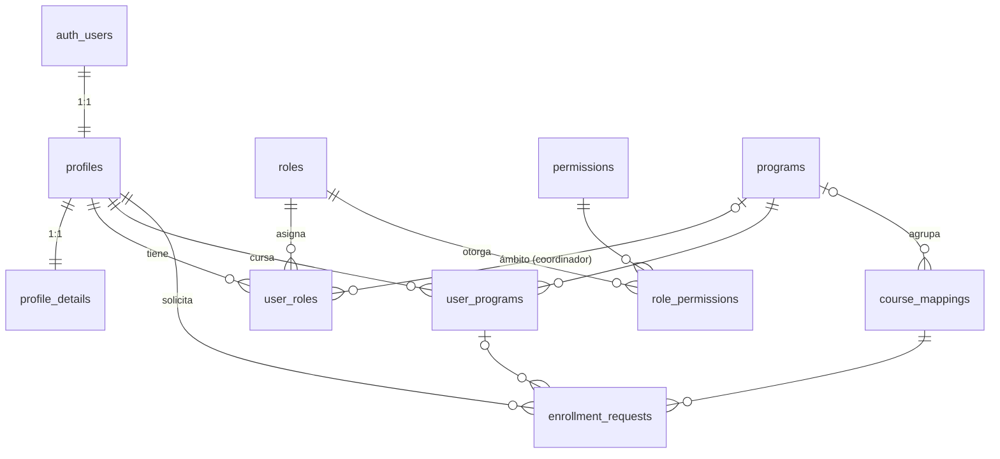

# IINICIA · Base de datos (Supabase · DEV)

Esquema PostgreSQL del portal IINICIA, derivado del documento de alcance técnico (secciones 5, 6, 7, 10 y 19).
Probado en PostgreSQL 16 con un stub de Supabase (RLS, triggers, auditoría y anti-escalada de roles).

## Estructura

```
supabase/
├── migrations/
│   ├── 20261022000100_extensions_schemas_types.sql   extensiones, esquema private, enums
│   ├── 20261022000200_tables_catalogs.sql            roles, permissions, role_permissions, programs
│   ├── 20261022000300_tables_users.sql               profiles, profile_details, user_roles, user_programs
│   ├── 20261022000400_tables_academic_audit.sql      course_mappings, enrollment_requests, audit_logs
│   ├── 20261022000500_indexes.sql                    índices (FK, búsqueda, únicos parciales, colas)
│   ├── 20261022000600_functions.sql                  helpers de RLS y funciones de trigger
│   ├── 20261022000700_triggers.sql                   updated_at, auditoría, guardas, alta desde Auth
│   ├── 20261022000800_seed_catalogs.sql              roles, permisos y matriz rol-permiso (todos los ambientes)
│   ├── 20261022000900_rls_policies.sql               Row Level Security
│   └── 20261022001000_views_grants.sql               vistas y privilegios (lista blanca)
├── seed.sql                                          solo DEV: los 2 cursos de ejemplo como programas
└── scripts/bootstrap_superadmin.sql                  crea el primer superadministrador
```

## Cómo aplicarlo

**Opción A (rápida, SQL Editor del dashboard):** pega `iinicia_schema_completo.sql` y ejecútalo. Después pega `seed.sql`.

**Opción B (Supabase CLI):** `supabase link --project-ref <ref>` y `supabase db push` (aplica `migrations/` en orden).

Luego: regístrate desde el portal (o Authentication → Users → Add user con *Auto Confirm*) y corre `scripts/bootstrap_superadmin.sql` con tu correo.

## Modelo



`audit_logs` queda aparte a propósito (sin FKs) para que la evidencia sobreviva al borrado de usuarios.

## Decisiones de diseño

- **Sin contraseñas propias:** `profiles` cuelga de `auth.users` (CA-04).
- **Alta automática:** el trigger `on_auth_user_created` crea `profiles`, `profile_details` y el rol `applicant`. Nunca lee roles ni estado de los metadatos del registro (son controlados por el usuario).
- **RBAC con permisos granulares** (`roles` → `role_permissions` → `permissions`) y `rank` para impedir escaladas: nadie otorga un rol de rank igual o mayor al suyo (salvo superadmin). No se puede retirar al último superadmin.
- **Coordinador acotado:** `user_roles.program_id` limita su alcance; sus políticas RLS usan `coordinates_*`, no permisos globales.
- **Un solo origen de "cursos autorizados":** `enrollment_requests`. Flujo `pending → approved → synced` (o `failed` reintentable). Mi IINICIA (`v_my_courses`) solo muestra `synced` y vigentes. Índice único parcial: no hay dos solicitudes abiertas al mismo curso.
- **Escrituras privilegiadas solo desde el backend (`service_role`).** El navegador solo lee (según RLS) y solo edita `first_name`, `last_name`, `phone` y sus detalles; `status`, `moodle_*` y roles no son escribibles por el cliente (GRANT por columna). Los administradores operan vía NestJS, que valida permisos del lado servidor.
- **Un administrador suspendido pierde sus permisos** al instante (los helpers exigen `status = 'active'`).
- **Auditoría (CA-19):** triggers en profiles, user_roles, programs, user_programs, course_mappings y enrollment_requests; en los UPDATE guarda solo los campos que cambiaron. `audit_logs` es append-only (bloqueado UPDATE/DELETE/TRUNCATE).
- **Baja lógica** (`deleted_at`) en `profiles` y `programs`.
- **Funciones en el esquema `private`:** no quedan expuestas como RPC en la API.
- **Índices:** uno por FK consultada, búsqueda difusa (pg_trgm) por nombre/correo, únicos parciales y cola de sincronización con Moodle.

## Contrato con el backend (NestJS)

- Usar la `service_role key` **solo** en el servidor.
- Para que la bitácora registre al administrador que actúa, ejecutar dentro de la transacción:
  `select set_config('app.actor_id', '<uuid-del-admin>', true);`
  (requiere conexión directa a Postgres; con supabase-js sin eso, `actor_id` queda `NULL` y conviene guardar el actor en `metadata` desde el backend).
- Matrícula: crear `enrollment_requests` → aprobar (`reviewed_at`) → matricular en Moodle → marcar `synced` + `synced_at`; si falla, `failed` + `sync_error` + `sync_attempts`.
- Usuario en Moodle: buscar antes de crear; guardar `moodle_user_id` y `moodle_sync_status = 'synced'` con `moodle_synced_at`.

## Pendiente para staging/producción

Aplicar las mismas migraciones (sin `seed.sql`) en cada proyecto nuevo.

# IINICIA · Base de datos (Supabase · DEV)

Esquema PostgreSQL del portal IINICIA, derivado del documento de alcance técnico
(secciones 5, 6, 7, 10 y 19). Probado en PostgreSQL 16 con un stub de Supabase
(RLS, triggers, auditoría y anti-escalada de roles).

---

## Proyecto Supabase (DEV)

| Variable | Valor |
|---|---|
| `DATABASE_PASSWORD` | Configurar fuera del repositorio mediante el gestor de secretos |
| `SUPABASE_URL` | `https://cdusxbpxtemwvhpfdqqr.supabase.co` |
| `SUPABASE_JWKS_URL` | `https://cdusxbpxtemwvhpfdqqr.supabase.co/auth/v1/.well-known/jwks.json` |
| Región | — |
| Ambiente | **DEV** (no usar para staging/producción) |

> Las claves (`SUPABASE_PUBLISHABLE_KEY`, `SUPABASE_SECRET_KEY`) **no se documentan aquí**.
> Viven únicamente en el archivo `.env` local / en el gestor de secretos del backend.
> Ver la sección [Variables de entorno](#variables-de-entorno).

---

## Estructura
