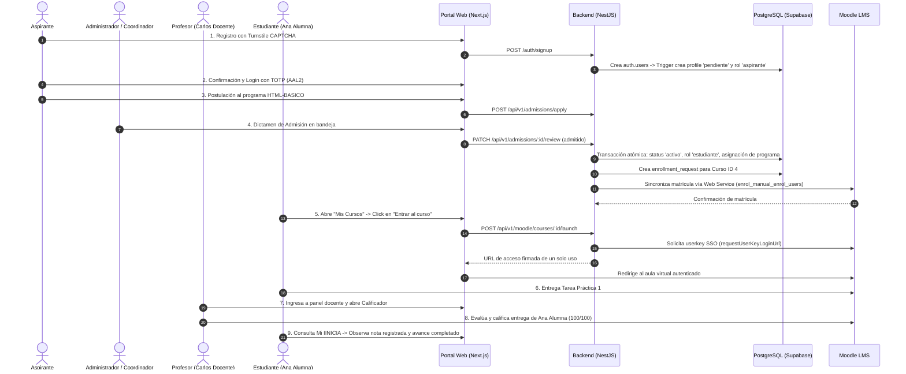

# Evidencia de Demostración del Curso Único en Moodle — Portal IINICIA

**Fecha de consolidación:** 14 de noviembre de 2026  
**Documentos de referencia:** [Proyecto Rediseño y Migración IINICIA](../Proyecto_Rediseno_Migracion_Portal_IINICIA_React_Moodle.md) (Secciones 8, 10, 11, 16 y 19), [Alcance Vigente](../ALCANCE.md), [Guía del Curso](cursos/html-basico/GUIA-MOODLE.txt), [Tema SCSS](moodle-theme.scss).  
**Criterios de aceptación:** `CA-07`, `CA-08`, `CA-09`, `CA-10`, `CA-11`, `CA-12`, `CA-13`, `CA-15`, `CA-17`.

---

## 1. Alcance Académico Acordado

Conforme al ajuste aprobado por el docente y formalizado en `ALCANCE.md`, la demostración integral de la plataforma opera sobre **un curso completo en Moodle LMS**:

| Parámetro | Valor Técnico |
|---|---|
| **Nombre del Curso** | **HTML Básico Desde Cero** |
| **Código del Programa** | `HTML-BASICO` |
| **ID del Programa en BD** | `6a7a5d42-97e8-4737-8071-f93cc88227d4` |
| **Código del Curso en Portal** | `005` |
| **ID de Mapeo en Portal (`course_mappings`)** | `d67c94c9-9132-4d45-8973-38d18b56307b` |
| **Moodle Course ID** | `4` |
| **Moodle Shortname** | `html-basico` |
| **URL Directa de Acceso en Moodle** | `http://192.168.191.171/moodle/course/view.php?id=4` |
| **Modalidad y Duración** | En línea · 40 horas académicas |

---

## 2. Cuentas de Prueba y Asignaciones de Rol (`CA-09`)

La validación contempla exactamente **un profesor y dos estudiantes** matriculados formalmente:

| Rol | Nombre Completo | Correo Institucional | Moodle Role | Role ID Moodle | Estado de Matrícula |
|---|---|---|---|:---:|:---:|
| **Profesor** | Carlos Docente | `profesor@iinicia.org` | `editingteacher` | 3 | Asignado y sincronizado |
| **Estudiante 1** | Ana Alumna | `estudiante1@iinicia.org` | `student` | 5 | Matriculada y sincronizada |
| **Estudiante 2** | Beto Alumno | `estudiante2@iinicia.org` | `student` | 5 | Matriculado y sincronizado |

> **Garantía de Seguridad:** Las cuentas no comparten contraseñas con Moodle. El ingreso se realiza mediante tokens SSO seguros (`auth_userkey`) generados por el backend en `POST /api/v1/moodle/courses/:id/launch`.

---

## 3. Estructura Pedagógica y Actividades en Moodle (`CA-08`)

El curso contiene las 4 actividades requeridas por el documento de proyecto con seguimiento de finalización (*activity completion tracking*):

1. **Recurso de Estudio / Lectura interactiva:**
   - *Actividad:* `HTML básico desde cero — Material interactivo`.
   - *Archivo:* `index.html` integrado con 9 módulos de teoría, laboratorio HTML en memoria y autoevaluación.
   - *Criterio de finalización:* El estudiante debe ver el recurso para completarlo.
2. **Foro de Discusión y Asesoría:**
   - *Actividad:* `Foro de Bienvenida y Dudas Técnicas`.
   - *Objetivo:* Interacción entre docente y estudiantes, resolución de consultas sobre etiquetas semánticas.
   - *Criterio de finalización:* El estudiante debe publicar o responder al menos un mensaje.
3. **Tarea Práctica Calificable:**
   - *Actividad:* `Tarea Práctica 1: Mi Primera Página HTML Semántica`.
   - *Consigna:* Construcción de un documento HTML5 con `header`, `nav`, `main`, `article`, `section` y `footer`.
   - *Criterio de finalización:* El estudiante debe enviar la entrega y recibir calificación del docente.
4. **Evaluación / Cuestionario:**
   - *Actividad:* `Evaluación Teórica: Fundamentos de la Web y Semántica`.
   - *Criterio de finalización:* Calificación aprobatoria mínima de 70/100.

---

## 4. Recorrido Demostrativo del Flujo Integral

---

## 5. Pruebas de Aislamiento y Resiliencia (`CA-12`, `CA-13`)

### Caso 1 · Estudiante no matriculado intenta ingresar al aula
- **Acción:** Un usuario con rol `estudiante` pero sin matrícula activa en el Curso ID 4 intenta solicitar un enlace de lanzamiento vía `POST /api/v1/moodle/courses/:id/launch`.
- **Resultado:** La API consulta `enrollment_requests` verificando `user_id = auth.uid()` y `status = 'sincronizada'`. Al no existir matrícula autorizada, devuelve HTTP `403 Forbidden` (`No estás matriculado en este curso`).

### Caso 2 · Profesor intenta acceder a un curso fuera de su asignación docente
- **Acción:** Un docente intenta consultar participantes o calificador de un curso no asignado a su cuenta.
- **Resultado:** `validateCourseAccess` comprueba en la base de datos la existencia de una matrícula con `moodle_role IN ('editingteacher', 'teacher')`. Al no existir asignación docente, la API devuelve HTTP `403 Forbidden` (`No posees permisos de docente en este curso`).

### Caso 3 · Caída de Moodle durante una baja (Desmatriculación tolerante a fallos)
- **Acción:** El estudiante o administración solicita la baja de una matrícula mientras Moodle no está disponible o responde con timeout.
- **Resultado:** `EnrollmentsService.deleteEnrollment` captura la excepción del Web Service, **no elimina el registro local**, actualiza el estado a `error_sincronizacion`, incrementa `sync_attempts = 1`, almacena el mensaje de error y emite el evento de auditoría `ENROLLMENT_UNENROL_FAILED`. Devuelve HTTP `503 Service Unavailable`, garantizando que la baja pueda reconciliarse posteriormente sin inconsistencia.

---

## 6. Coherencia Visual Portal — Moodle (`CA-17`)

El aula virtual de Moodle incorpora la personalización de estilos mediante el archivo [`docs/moodle-theme.scss`](moodle-theme.scss) aplicado sobre el tema oficial **Boost**:

| Elemento Visual | Portal Next.js | Campus Virtual Moodle (Tema Boost) | Coherencia Lograda |
|---|---|---|:---:|
| **Barra Superior** | `#101710` (Bosque Profundo) | `.navbar { background: #101710 !important; }` | **100%** |
| **Acento de Marca** | `#bef264` (Lima Eléctrico) | Botones primarios, insignias de estado y focos activos | **100%** |
| **Tarjetas y Cursos** | Bordes `#dce5d2`, esquinas redondeadas 14px | `.coursebox, .activity-item { border-radius: 14px; }` | **100%** |
| **Fondo Principal** | `#f5f8ef` (Tono neutro claro) | `#page.drawers { background: #f5f8ef; }` | **100%** |
| **Sin Dependencias de Core** | CSS puro sin constructores | Inyección en el campo SCSS del tema Boost | **100%** |
