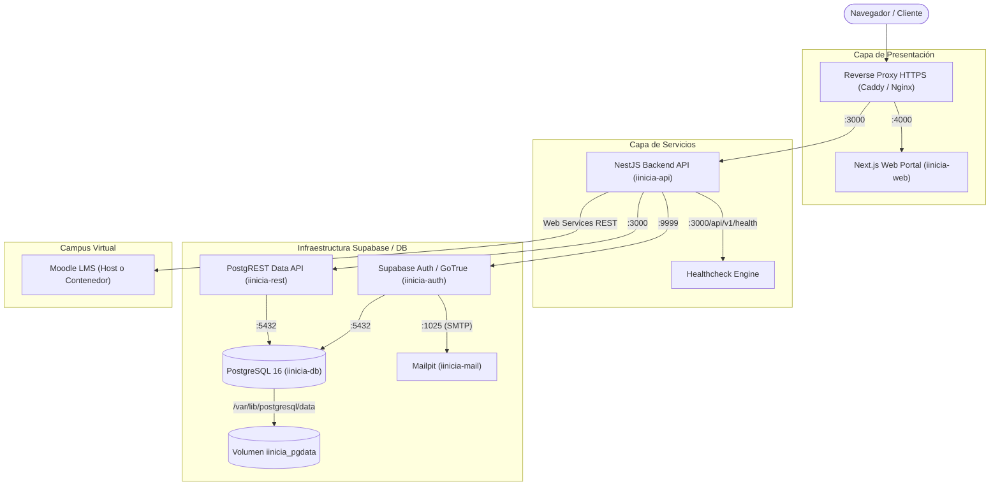

# Despliegue y Recuperación — Entorno de Entrega IINICIA

Este documento define la instalación reproducible de la plataforma IINICIA (Portal Next.js, Backend NestJS, Supabase PostgreSQL/Auth/Rest y Moodle LMS), sus comprobaciones de salud, configuración de variables, terminación HTTPS y procedimientos de respaldo y restauración en aislamiento (Criterios CA-18 y CA-20).

---

## 1. Arquitectura de Despliegue

La plataforma se orquesta mediante Docker Compose en redes aisladas:



---

## 2. Puesta en Marcha Rápida (Despliegue Local / Pruebas)

### Requisitos previos
- Docker Engine >= 24.0 (probado con v29.9.2)
- Docker Compose >= 2.20 (probado con v5.6.1)
- Puertos disponibles: `3000` (API), `4000` (Web), `5432` (DB), `9999` (Auth), `3001` (Rest), `8025` (Mailpit UI).

### Pasos de ejecución

1. **Configurar el entorno:**
   ```bash
   cd docker
   cp .env.example .env
   # Editar .env y definir claves secretas seguras (JWT_SECRET, contraseñas de BD)
   ```

2. **Iniciar el stack completo:**
   ```bash
   docker compose up -d
   ```

3. **Verificar el estado de los contenedores:**
   ```bash
   docker compose ps
   ```

4. **Acceso a los servicios:**
   - **Portal Web:** `http://localhost:4000`
   - **Backend API:** `http://localhost:3000/api/v1/health`
   - **Supabase Auth:** `http://localhost:9999/health`
   - **Mailpit (Buzón de correos local):** `http://localhost:8025`

---

## 3. Comprobaciones de Salud (`Healthchecks`)

Todos los servicios críticos cuentan con sondas de disponibilidad:

| Servicio | Tipo de prueba | Endpoint / Comando | Intervalo | Retries |
| :--- | :--- | :--- | :--- | :--- |
| `db` | `CMD-SHELL` | `pg_isready -U postgres -d postgres` | 10s | 5 |
| `api` | `CMD` | `wget -qO- http://localhost:3000/api/v1/health` | 15s | 3 |
| `web` | `CMD` | `wget -qO- http://localhost:4000/` | 20s | 3 |

Para auditar el estado de salud de todos los contenedores:
```bash
docker compose ps --format "table {{.Name}}\t{{.Status}}\t{{.Ports}}"
```

---

## 4. Configuración de Moodle LMS

IINICIA soporta dos modalidades de integración para Moodle:

### Opción A: Moodle nativo en el servidor host (Recomendado en el servidor actual)
El contenedor NestJS se comunica con el Moodle del host mediante `host.docker.internal:host-gateway`:
- En `docker/.env`:
  ```env
  MOODLE_URL=http://host.docker.internal/moodle
  MOODLE_BASE_URL=http://host.docker.internal/moodle
  MOODLE_WS_TOKEN=<token_de_web_services_generado_en_moodle>
  ```

### Opción B: Moodle contenedorizado desde cero
Si se despliega en una máquina limpia sin Moodle previo, activar el perfil `full-lms`:
```bash
docker compose --profile full-lms up -d
```
Esto levantará automáticamente `iinicia-moodle` (puerto `8080`) y `iinicia-moodle-db` (MariaDB).

---

## 5. Terminación HTTPS / TLS en Producción

Para cumplir con el estándar de seguridad y proteger cookies, credenciales y tokens JWT, se recomienda utilizar **Caddy** o **Nginx** como terminador TLS frente a los contenedores:

### Configuración con Caddy (`Caddyfile` de producción):
```caddy
portal.iinicia.org {
    reverse_proxy localhost:4000
}

api.iinicia.org {
    reverse_proxy localhost:3000
}

campus.iinicia.org {
    reverse_proxy localhost/moodle
}
```

### Directivas de Seguridad HTTP recomendadas:
- `Strict-Transport-Security: max-age=63072000; includeSubDomains; preload`
- `X-Content-Type-Options: nosniff`
- `X-Frame-Options: SAMEORIGIN`
- `Referrer-Policy: strict-origin-when-cross-origin`

---

## 6. Procedimiento de Respaldo (Backup)

Los respaldos deben ejecutarse de forma periódica y antes de cualquier migración o actualización mayor.

### 6.1 Respaldo de Base de Datos PostgreSQL / Supabase
Genera un volcado completo de esquema y datos (sin secretos de conexión expuestos):
```bash
TIMESTAMP=$(date +%Y%m%d_%H%M%S)
BACKUP_DIR="/var/backups/iinicia"
mkdir -p "$BACKUP_DIR"

docker exec -t iinicia-db pg_dumpall -U postgres > "$BACKUP_DIR/iinicia_db_$TIMESTAMP.sql"
gzip -9 "$BACKUP_DIR/iinicia_db_$TIMESTAMP.sql"
```

### 6.2 Respaldo de Datos Moodle (moodledata y MariaDB)
```bash
# Base de datos de Moodle
mysqldump -u root -p bitnami_moodle > "$BACKUP_DIR/moodle_db_$TIMESTAMP.sql"
gzip -9 "$BACKUP_DIR/moodle_db_$TIMESTAMP.sql"

# Directorio de archivos de estudiantes y cursos
tar -czpf "$BACKUP_DIR/moodledata_$TIMESTAMP.tar.gz" -C /var/www moodledata
```

---

## 7. Procedimiento de Restauración en Aislamiento

Para verificar la integridad de un respaldo sin afectar el entorno productivo:

1. **Crear una base de datos aislada temporal:**
   ```bash
   docker exec -i iinicia-db psql -U postgres -c "CREATE DATABASE restore_test_recovery;"
   ```

2. **Descomprimir y restaurar el volcado:**
   ```bash
   gunzip -c "$BACKUP_DIR/iinicia_db_YYYYMMDD_HHMMSS.sql.gz" | \
     docker exec -i iinicia-db psql -U postgres -d restore_test_recovery -v ON_ERROR_STOP=1
   ```

3. **Verificar la consistencia del esquema y datos restaurados:**
   ```bash
   # Comprobar conteo de tablas y roles
   docker exec -i iinicia-db psql -U postgres -d restore_test_recovery -c "
     SELECT count(*) as total_tablas FROM information_schema.tables WHERE table_schema = 'public';
     SELECT count(*) as total_roles FROM public.roles;
     SELECT count(*) as total_programas FROM public.programs;
   "
   ```

4. **Eliminar el entorno de prueba de restauración:**
   ```bash
   docker exec -i iinicia-db psql -U postgres -c "DROP DATABASE restore_test_recovery;"
   ```

---

## 8. Procedimiento de Actualización de Versión

1. Obtener la última versión del código: `git pull origin main`.
2. Reconstruir imágenes de aplicación:
   ```bash
   docker compose build api web
   ```
3. Reiniciar los servicios con tiempo de inactividad mínimo:
   ```bash
   docker compose up -d --no-deps api web
   ```
4. Comprobar salud:
   ```bash
   curl -f http://localhost:3000/api/v1/health
   ```

## Arranque estándar en producción

Usar Node.js 22 y ejecutar `npm ci` y `npm run build` en cada aplicación al instalar una revisión nueva. Después, `npm start` arranca lo compilado. Reiniciar con el mismo comando reutiliza la compilación. El script `dev:demo` se reserva para desarrollo local, y los accesos rápidos de prueba solo aparecen en desarrollo.

### Portal en Vercel y API en Ubuntu

- Importar el repositorio en Vercel, seleccionar Next.js, configurar `apps/web` como directorio raíz y `main` como rama de producción. Usar el comando de compilación detectado (`npm run build`) y dejar que Vercel administre la ejecución.
- Definir `NEXT_PUBLIC_API_URL=https://api.example.org/api/v1` con el dominio real de la API, además de las variables públicas del portal que requiera el ambiente. Las variables `NEXT_PUBLIC_*` se incorporan durante la compilación. Cambiarlas requiere una compilación y despliegue nuevos.
- Ejecutar NestJS en Ubuntu con su configuración de servidor. Exponer API y Moodle mediante HTTPS con direcciones accesibles por los usuarios. Configurar `FRONTEND_URL` y `CORS_ORIGIN` con el dominio del portal y autorizar sus URLs de confirmación y recuperación en Supabase. Las credenciales de servicio pertenecen al backend.

### Portal y API en Ubuntu

En terminales separadas, con las variables del ambiente ya configuradas:

```bash
# API
cd apps/api
npm ci
npm run build
npm start
```

```bash
# Portal, desde la raíz del repositorio
cd apps/web
npm ci
npm run build
npm start
```

La API escucha por defecto en el puerto 3000 y el portal en el 4000. `PORT` permite cambiar el puerto de cada proceso. Para mantenerlos activos en el VPS, usar Docker Compose o un supervisor como systemd y publicar sus dominios a través del proxy HTTPS. En producción, configurar la URL pública HTTPS de la API antes de compilar el portal.

Antes del corte, verificar la salud de la API, la carga del portal desde su dominio público, el inicio de sesión y la entrada a Moodle. Probar primero en un entorno de ensayo con la misma configuración de red y HTTPS.
