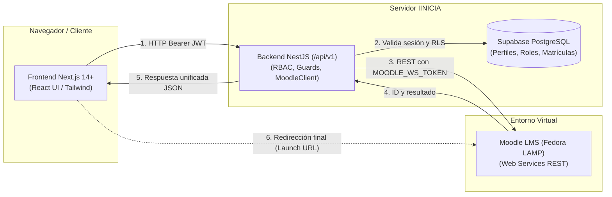
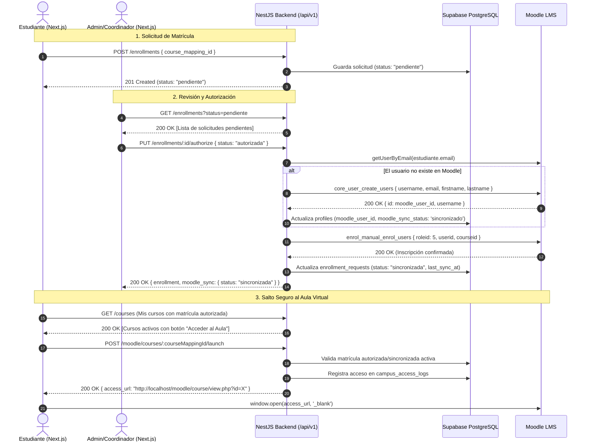

# Guía de Integración para el Frontend (Next.js / React) — IINICIA Portal

> Documento histórico. La guía vigente del frontend está en [frontend.md](frontend.md) y el contrato verificable en [openapi.yaml](openapi.yaml). Las rutas, colores, identificadores y ejemplos de este documento pueden no corresponder a la implementación actual.

> **Audiencia**: Equipo de Desarrollo Frontend (Next.js 14+ / React / Tailwind CSS)  
> **Backend API**: NestJS + Supabase (PostgreSQL 15+) + Moodle LMS (Web Services)  
> **Prefijo Global de API**: `/api/v1`  
> **URL Base Local**: `http://localhost:3000/api/v1` (o la variable `NEXT_PUBLIC_API_URL`)  
> **Especificación OpenAPI Interactiva (Swagger/Scalar)**: `http://localhost:3000/api/v1/docs`  
> **Contrato OpenAPI YAML descargable**: `http://localhost:3000/api/v1/openapi.yaml`

---

## 1. Arquitectura General y Reglas de Comunicación

### 1.1 Variables de Entorno del Frontend (`apps/web/.env.local`)
```env
# URL de la API de NestJS
NEXT_PUBLIC_API_URL=http://localhost:3000/api/v1

# Supabase Auth para el cliente del navegador (NUNCA incluir Service Role Key aquí)
NEXT_PUBLIC_SUPABASE_URL=https://mmtuaangwbsdtddeplfv.supabase.co
NEXT_PUBLIC_SUPABASE_ANON_KEY=sb_publishable_B-Q9_19Fj_gdw0tkg6c4IA_ctO7Rz-V

# URL de Moodle para enlaces institucionales
NEXT_PUBLIC_MOODLE_URL=http://localhost/moodle
```

### 1.2 Headers Globales de Solicitud
Toda petición a endpoints protegidos debe incluir el token Bearer emitido por Supabase Auth:
```http
Authorization: Bearer <access_token>
Content-Type: application/json
```

### 1.3 Formato Estándar de Errores HTTP
Todos los errores de la API devuelven una estructura predecible:
```json
{
  "statusCode": 400,
  "message": ["El correo electrónico debe ser válido.", "La contraseña debe tener mínimo 8 caracteres"],
  "error": "Bad Request"
}
```
Códigos HTTP estándar utilizados:
- `200 OK`: Operación exitosa con datos de retorno.
- `201 Created`: Recurso creado exitosamente (registro, matrícula, mensaje de contacto).
- `400 Bad Request`: Error de validación en DTO de entrada.
- `401 Unauthorized`: Token ausente, expirado o firma inválida.
- `403 Forbidden`: El usuario no posee el rol o permiso requerido para la acción.
- `404 Not Found`: El recurso solicitado (curso, usuario, programa) no existe.
- `409 Conflict`: Conflicto de estado (ej: usuario ya registrado, matrícula duplicada).
- `429 Too Many Requests`: Límite de peticiones excedido (Rate limiting activo: 30 peticiones/minuto en auth).

---

## 2. Flujo de Autenticación e Identidad con Supabase

### 2.1 Flujo de Registro (`POST /api/v1/auth/register`)
- **Público**: Cualquier visitante puede registrarse.
- **Estado Inicial**: Se le asigna automáticamente el rol `aspirante` y estado de cuenta `pendiente`.
- **Ejemplo de Request**:
```json
POST /api/v1/auth/register
Content-Type: application/json

{
  "email": "estudiante.nuevo@ejemplo.com",
  "password": "Password123!",
  "first_name": "Laura",
  "last_name": "García",
  "phone": "5551234567"
}
```
- **Ejemplo de Respuesta (`201 Created`)**:
```json
{
  "user": {
    "id": "e4b2d184-98c1-4b13-98fe-3bc47d2f951e",
    "email": "estudiante.nuevo@ejemplo.com",
    "first_name": "Laura",
    "last_name": "García",
    "status": "pendiente",
    "roles": ["aspirante"],
    "permissions": ["admissions.apply", "cms.read"]
  },
  "session": {
    "access_token": "eyJhbGciOiJIUzI1NiIsInR5cCI6IkpXVCJ9...",
    "refresh_token": "...",
    "token_type": "bearer",
    "expires_in": 3600
  }
}
```

### 2.2 Flujo de Login (`POST /api/v1/auth/login`)
- **Request**:
```json
POST /api/v1/auth/login
Content-Type: application/json

{
  "email": "estudiante.nuevo@ejemplo.com",
  "password": "Password123!"
}
```
- **Respuesta (`200 OK`)**:
```json
{
  "access_token": "eyJhbGciOiJIUzI1NiIsInR5cCI6IkpXVCJ9...",
  "refresh_token": "...",
  "token_type": "bearer",
  "expires_in": 3600,
  "user": {
    "id": "e4b2d184-98c1-4b13-98fe-3bc47d2f951e",
    "email": "estudiante.nuevo@ejemplo.com",
    "first_name": "Laura",
    "last_name": "García",
    "status": "activo",
    "roles": ["estudiante"],
    "permissions": ["courses.view_enrolled", "moodle.access"]
  }
}
```

### 2.3 Obtener Sesión Actual (`GET /api/v1/auth/me`)
Utilizar al iniciar la aplicación en Next.js o en un AuthProvider para restaurar la sesión del usuario.
- **Header**: `Authorization: Bearer <access_token>`
- **Respuesta (`200 OK`)**:
```json
{
  "id": "e4b2d184-98c1-4b13-98fe-3bc47d2f951e",
  "email": "estudiante.nuevo@ejemplo.com",
  "first_name": "Laura",
  "last_name": "García",
  "status": "activo",
  "roles": ["estudiante"],
  "permissions": [
    "courses.view_enrolled",
    "enrollments.request",
    "moodle.access"
  ],
  "moodle_user_id": 104,
  "moodle_username": "laura_garcia"
}
```

### 2.4 Jerarquía de Roles de Usuario
En el frontend, usar estos slugs oficiales para renderizar paneles diferenciados:
| Rol Slug | Nombre Visible | Nivel de Acceso | Panel Frontend Sugerido |
| :--- | :--- | :--- | :--- |
| `superadministrador` | Superadministrador | Acceso total al sistema | `/admin/super` |
| `administrador` | Administrador | Gestión de usuarios, cursos, matrículas | `/admin` |
| `coordinador` | Coordinador Académico | Aprobación de matrículas y programas | `/coordinador` |
| `profesor` | Profesor / Docente | Cursos asignados y alumnos matriculados | `/docente` |
| `estudiante` | Estudiante / Alumno | Cursos inscritos y acceso al Campus Moodle | `/estudiante` |
| `soporte` | Soporte Técnico | Mensajes de contacto y logs de auditoría | `/soporte` |
| `aspirante` | Aspirante | Solicitud de admisión y catálogo de programas | `/aspirante` |

---

## 3. Integración con Moodle LMS (Campus Virtual) y Frontend

### 3.1 Principio de Arquitectura Tripartita

> [!IMPORTANT]
> **El Frontend (Next.js) NUNCA se comunica directamente con Moodle LMS.**  
> Todas las operaciones pasan por el backend en NestJS (`/api/v1`), el cual actúa como Backend-For-Frontend (BFF), validando los permisos del usuario con Supabase Auth y ejecutando llamadas seguras con credenciales de servidor (`MOODLE_WS_TOKEN`).



---

### 3.2 Cursos Oficiales Configurados en Moodle
En la base de datos y en Moodle local ya existen los dos cursos maestros obligatorios:
1. **Curso 1: Introducción a las Tecnologías de la Información**
   - **Moodle Course ID**: `3`
   - **Moodle Shortname**: `IINICIA-TI-101`
   - **Código en Portal**: `CUR-MOO-001`
   - **UUID de mapeo en BD**: `671820a5-88fc-4158-a3e8-c2d2dfcc9ffb`
2. **Curso 2: Desarrollo Web con React**
   - **Moodle Course ID**: `2`
   - **Moodle Shortname**: `IINICIA-REACT-102`
   - **Código en Portal**: `CUR-MOO-002`
   - **UUID de mapeo en BD**: `1617d4b7-920d-439b-aa16-bb8d2e7516b7`

---

### 3.3 Correspondencia de Roles (Portal vs Moodle)

| Rol en Portal IINICIA | Rol en Moodle LMS | Moodle `roleid` | ¿Tiene acceso directo a cursos? |
| :--- | :--- | :---: | :--- |
| `estudiante` | Student (Estudiante) | `5` | **Sí**, únicamente a cursos con matrícula autorizada. |
| `profesor` | Editing Teacher (Profesor con edición) | `3` | **Sí**, a cursos que tenga asignados para impartir. |
| `coordinador` | Manager / Course Creator | `1` | Supervisión académica y catálogo de cursos. |
| `administrador` / `superadministrador` | Manager / Administrator | `1` | Gestión total de usuarios y sincronizaciones. |
| `aspirante` | *(Sin cuenta en Moodle)* | — | **No**. Solo navega el catálogo y postula a admisiones. |

---

### 3.4 Flujo Académico Completo de Inscripción y Sincronización



---

### 3.5 Estados de Sincronización con Moodle en el Frontend

En las respuestas de `/api/v1/users`, `/api/v1/auth/me` y `/api/v1/enrollments`, el campo `moodle_sync_status` adopta los siguientes valores:

| Valor de `moodle_sync_status` | Significado para la UI | Badge Sugerido (Tailwind) | Acción de la UI |
| :--- | :--- | :--- | :--- |
| `sincronizado` | La cuenta/matrícula existe y está activa en Moodle. | `bg-emerald-100 text-emerald-800` | Habilitar botón "Acceder al Aula Virtual". |
| `no_vinculado` | Usuario recién registrado o aspirante sin cursos aprobados. | `bg-gray-100 text-gray-800` | Mostrar "Sin vincular al campus". |
| `pendiente` | Solicitud en proceso de sincronización o reintento. | `bg-amber-100 text-amber-800` | Mostrar spinner o mensaje "Sincronizando...". |
| `error` | Falló la comunicación con Moodle o parámetro inválido. | `bg-rose-100 text-rose-800` | Mostrar badge de error y botón de "Reintentar" (Admin). |
| `suspendido_en_moodle` | La cuenta fue suspendida administrativamente en el portal. | `bg-red-100 text-red-800` | Mostrar "Acceso al campus revocado". |

---

### 3.6 Endpoint de Salto al Campus Moodle (`POST /api/v1/moodle/courses/:courseMappingId/launch`)
- **Autenticación**: Obligatoria (`Bearer <token>`).
- **Seguridad y Control de Acceso**:
  - Si el usuario no tiene matrícula con estado `autorizada` o `sincronizada`, la API rechaza con `403 Forbidden` y mensaje `"No cuentas con una matrícula autorizada para este curso."`.
  - Registra cada acceso en `campus_access_logs` (IP, fecha y User-Agent).
- **Request**:
```http
POST /api/v1/moodle/courses/1617d4b7-920d-439b-aa16-bb8d2e7516b7/launch
Authorization: Bearer <access_token>
```
- **Respuesta Exitosa (`200 OK`)**:
```json
{
  "course_mapping_id": "1617d4b7-920d-439b-aa16-bb8d2e7516b7",
  "course_name": "Curso 2. Desarrollo Web con React",
  "moodle_course_id": 2,
  "access_url": "http://localhost/moodle/course/view.php?id=2"
}
```

---

### 3.7 Endpoints Administrativos de Moodle (Para Paneles de Admin / Coordinador)

#### 1. Comprobación de Salud de Moodle (`GET /api/v1/moodle/status`)
Permite mostrar en el Dashboard un widget con el estado del servidor de Moodle.
- **Respuesta (`200 OK`)**:
```json
{
  "ok": true,
  "message": "Conectado a Moodle: Campus Virtual IINICIA"
}
```

#### 2. Sincronización Masiva de Usuarios (`POST /api/v1/moodle/sync/users`)
Permite al administrador sincronizar con un solo clic a todos los usuarios que aún no tienen cuenta en Moodle.
- **Roles requeridos**: `superadministrador`, `administrador`.
- **Respuesta (`200 OK`)**:
```json
{
  "total": 8,
  "synced": 8,
  "failed": 0,
  "results": [
    {
      "id": "dda494b9-c639-4f55-8848-011b53cbac38",
      "email": "admin@iinicia.org",
      "status": "sincronizado",
      "moodle_user_id": 105,
      "moodle_username": "admin_iinicia"
    }
  ]
}
```

#### 3. Sincronización Individual de Usuario (`POST /api/v1/moodle/sync/user/:userId`)
Sincroniza o fuerza la actualización de un usuario específico en Moodle LMS.

#### 4. Reintento de Sincronización de Matrícula (`POST /api/v1/moodle/sync/enrollment/:enrollmentId`)
Si Moodle estuvo temporalmente inaccesible cuando se autorizó una matrícula, este endpoint reintenta la inscripción en Moodle.

---

### 3.8 Ejemplo de Componente React / Next.js: Botón de Salto al Curso

A continuación se muestra una implementación recomendada para el componente del aula virtual en React:

```tsx
'use client';

import React, { useState } from 'react';

interface LaunchCourseButtonProps {
  courseMappingId: string;
  courseName: string;
  isAuthorized: boolean;
  accessToken: string;
}

export function LaunchCourseButton({
  courseMappingId,
  courseName,
  isAuthorized,
  accessToken,
}: LaunchCourseButtonProps) {
  const [loading, setLoading] = useState(false);
  const [error, setError] = useState<string | null>(null);

  const handleLaunch = async () => {
    if (!isAuthorized) {
      setError('Aún no tienes matrícula autorizada para este curso.');
      return;
    }

    try {
      setLoading(true);
      setError(null);

      const res = await fetch(
        `${process.env.NEXT_PUBLIC_API_URL}/moodle/courses/${courseMappingId}/launch`,
        {
          method: 'POST',
          headers: {
            Authorization: `Bearer ${accessToken}`,
            'Content-Type': 'application/json',
          },
        },
      );

      const data = await res.json();

      if (!res.ok) {
        throw new Error(data.message || 'No fue posible acceder al aula virtual.');
      }

      // Redirigir o abrir el curso de Moodle en nueva pestaña
      window.open(data.access_url, '_blank', 'noopener,noreferrer');
    } catch (err: any) {
      setError(err.message);
    } finally {
      setLoading(false);
    }
  };

  return (
    <div className="flex flex-col gap-1">
      <button
        onClick={handleLaunch}
        disabled={loading || !isAuthorized}
        className={`px-4 py-2 font-medium text-white rounded-lg transition-colors flex items-center justify-center gap-2 ${
          isAuthorized
            ? 'bg-blue-600 hover:bg-blue-700 disabled:opacity-50'
            : 'bg-gray-400 cursor-not-allowed'
        }`}
      >
        {loading ? (
          <>
            <span className="animate-spin inline-block w-4 h-4 border-2 border-white border-t-transparent rounded-full" />
            Abriendo aula virtual...
          </>
        ) : (
          `Entrar al curso: ${courseName}`
        )}
      </button>

      {error && (
        <span className="text-xs text-red-600 font-medium">
          {error}
        </span>
      )}
    </div>
  );
}
```

---

## 4. Referencia de Endpoints por Módulo

### 4.1 Programas Académicos (Público y Administrativo)

#### `GET /api/v1/programs`
Obtiene la lista de programas académicos.
- **Público**: No requiere token. Filtra automáticamente programas con `is_active: true`.
- **Query Params opcionales**:
  - `type`: `licenciatura` | `maestria` | `diplomado` | `curso`
  - `modality`: `en_linea` | `presencial` | `hibrido` | `autogestivo`
- **Respuesta (`200 OK`)**:
```json
[
  {
    "id": "a87fa37d-73ed-4bf8-9fe9-bee188968642",
    "code": "PROG-TI-001",
    "slug": "introduccion-a-las-tecnologias-de-la-informacion",
    "name": "Introducción a las Tecnologías de la Información",
    "short_description": "Fundamentos esenciales de infraestructura digital, redes y software.",
    "description": "Programa formativo diseñado para desarrollar competencias sólidas...",
    "type": "curso",
    "modality": "en_linea",
    "duration_text": "4 semanas",
    "duration_hours": 40,
    "is_featured": true,
    "is_active": true
  }
]
```

#### `GET /api/v1/programs/:idOrSlug`
Obtiene el detalle completo de un programa por su UUID o su slug amigable.
- **Ejemplo**: `GET /api/v1/programs/desarrollo-web-con-react`

---

### 4.2 Cursos y Catálogo Mapeado

#### `GET /api/v1/courses`
- **Para Estudiantes y Profesores**: Devuelve exclusivamente los cursos autorizados en la vista `v_user_authorized_courses`.
- **Para Administradores / Coordinadores**: Devuelve el catálogo completo de mapeos con Moodle.
- **Respuesta para Estudiante (`200 OK`)**:
```json
[
  {
    "course_id": "1617d4b7-920d-439b-aa16-bb8d2e7516b7",
    "portal_course_code": "CUR-MOO-002",
    "course_name": "Curso 2. Desarrollo Web con React",
    "moodle_course_id": 2,
    "moodle_shortname": "IINICIA-REACT-102",
    "role": "estudiante",
    "enrollment_status": "autorizada"
  }
]
```

---

### 4.3 Matrículas e Inscripciones (`/api/v1/enrollments`)

#### `GET /api/v1/enrollments`
- **Estudiantes**: Consulta su historial personal de solicitudes de inscripción.
- **Admin / Coordinador**: Consulta todas las inscripciones del portal ordenadas por fecha.

#### `POST /api/v1/enrollments`
Crea una solicitud de inscripción a un curso.
- **Header**: `Authorization: Bearer <token>`
- **Request Body**:
```json
{
  "course_mapping_id": "1617d4b7-920d-439b-aa16-bb8d2e7516b7",
  "notes": "Inscripción correspondiente al periodo intensivo 2026."
}
```
- **Respuesta (`201 Created`)**:
```json
{
  "id": "b319f390-449e-4e08-9df2-f58c7328bf36",
  "user_id": "e4b2d184-98c1-4b13-98fe-3bc47d2f951e",
  "course_mapping_id": "1617d4b7-920d-439b-aa16-bb8d2e7516b7",
  "status": "pendiente",
  "moodle_sync_status": "pendiente",
  "created_at": "2026-10-24T15:20:00.000Z"
}
```

#### `PATCH /api/v1/enrollments/:id/status`
Aprueba, rechaza o desmatricula a un estudiante.
- **Permisos requeridos**: `superadministrador`, `administrador` o `coordinador`.
- **Request Body**:
```json
{
  "status": "autorizada",
  "sync_to_moodle": true,
  "notes": "Aprobado tras validación de requisitos."
}
```
- **Respuesta (`200 OK`)**:
```json
{
  "enrollment": {
    "id": "b319f390-449e-4e08-9df2-f58c7328bf36",
    "status": "autorizada",
    "authorized_at": "2026-10-24T15:25:00.000Z"
  },
  "moodle_sync": {
    "success": true,
    "status": "sincronizada",
    "moodle_course_id": 2,
    "moodle_user_id": 104
  }
}
```

#### `POST /api/v1/enrollments/:id/sync`
Fuerza o reintenta manualmente la sincronización de una matrícula con Moodle.
- **Permisos requeridos**: `moodle.sync.execute`

---

### 4.4 Gestión de Usuarios y Perfiles (`/api/v1/users`)

#### `GET /api/v1/users`
Listado paginado de usuarios con soporte para búsqueda difusa (`pg_trgm`).
- **Permisos requeridos**: Administrador / Coordinador / Soporte.
- **Query Params**:
  - `page`: número de página (default: 1)
  - `limit`: elementos por página (default: 20)
  - `search`: busca por nombre, apellido o correo (ej: `?search=laura`)
  - `role`: filtra por rol (ej: `?role=estudiante`)
  - `status`: filtra por estado (`pendiente`, `activo`, `suspendido`, `inactivo`, `baja`)
- **Respuesta (`200 OK`)**:
```json
{
  "data": [
    {
      "id": "e4b2d184-98c1-4b13-98fe-3bc47d2f951e",
      "email": "laura.garcia@ejemplo.com",
      "first_name": "Laura",
      "last_name": "García",
      "status": "activo",
      "moodle_user_id": 104,
      "roles": ["estudiante"]
    }
  ],
  "meta": {
    "page": 1,
    "limit": 20,
    "total": 1
  }
}
```

#### `PATCH /api/v1/users/:id/status`
Modifica el estado de una cuenta. Si se suspende o desactiva, el backend suspende inmediatamente al usuario en Moodle LMS (`core_user_update_users` con `suspended: 1`).
- **Request Body**:
```json
{
  "status": "suspendido",
  "reason": "Adeudo administrativo pendiente."
}
```

#### `PATCH /api/v1/users/me/profile`
Permite al usuario autenticado actualizar sus datos personales (nombre, teléfono, avatar, preferencias).

---

### 4.5 Admisiones para Aspirantes (`/api/v1/admissions`)

#### `POST /api/v1/admissions/apply`
Envía una postulación formal a un programa académico.
- **Permiso**: Aspirantes autenticados.
- **Request Body**:
```json
{
  "program_id": "c12a3e60-c65d-4720-9737-07008b3e7f1e",
  "statement_of_purpose": "Deseo especializarme en desarrollo frontend y React.",
  "documents": [
    { "type": "identificacion", "url": "https://..." },
    { "type": "comprobante_estudios", "url": "https://..." }
  ]
}
```

#### `POST /api/v1/admissions/:id/review`
Emite un dictamen sobre la solicitud de admisión (`admitido`, `rechazado`, `en_revision`).
- Si se emite `admitido`, el sistema **activa la cuenta del aspirante** y le asigna automáticamente el rol `estudiante`.

---

### 4.6 CMS Institucional y Migración WordPress

#### `GET /api/v1/cms/contents`
Obtiene las páginas, noticias o comunicados institucionales publicados.
- **Público**: No requiere token.
- **Query Params**: `?type=pagina` | `?type=noticia` | `?type=aviso`

#### `GET /api/v1/cms/contents/:slug`
Obtiene el contenido completo y metadatos SEO de una página institucional.
- **Páginas disponibles**:
  - `/api/v1/cms/contents/quienes-somos`
  - `/api/v1/cms/contents/modelo-educativo`

#### `GET /api/v1/directory`
Directorio de autoridades, coordinadores y cuerpo docente institucional.

#### `POST /api/v1/contact`
Procesa el formulario público de contacto del portal.
- **Request Body**:
```json
{
  "full_name": "Roberto Mendoza",
  "email": "roberto@ejemplo.com",
  "phone": "5559876543",
  "subject": "Informes sobre Diplomado React",
  "message": "Quisiera conocer el costo y la fecha del próximo ciclo."
}
```
- **Respuesta (`201 Created`)**:
```json
{
  "success": true,
  "message_id": "90e6db6f-b258-45e0-9bc6-98ecbc21de54",
  "submitted_at": "2026-10-24T15:30:00.000Z"
}
```

#### `GET /api/v1/migration/redirects`
Devuelve el mapa completo de redirecciones 301 del WordPress anterior a las nuevas rutas de Next.js.
- **Uso en Frontend**: Consumir en el archivo `middleware.ts` de Next.js para redirigir URLs legacy de WordPress a las nuevas páginas.

---

## 5. TypeScript Interfaces Compartidas (Copiar en `apps/web`)

Puedes copiar el siguiente bloque directamente en tu proyecto Next.js en `apps/web/src/types/api.ts`:

```typescript
export type UserStatus = 'pendiente' | 'activo' | 'suspendido' | 'inactivo' | 'baja';

export type UserRoleSlug =
  | 'superadministrador'
  | 'administrador'
  | 'coordinador'
  | 'profesor'
  | 'estudiante'
  | 'soporte'
  | 'aspirante';

export type EnrollmentStatus =
  | 'pendiente'
  | 'autorizada'
  | 'rechazada'
  | 'sincronizada'
  | 'error_sincronizacion'
  | 'desmatriculada';

export interface UserProfile {
  id: string;
  email: string;
  first_name: string;
  last_name: string;
  status: UserStatus;
  roles: UserRoleSlug[];
  permissions: string[];
  moodle_user_id?: number | null;
  moodle_username?: string | null;
  avatar_url?: string | null;
  phone?: string | null;
}

export interface AuthSession {
  access_token: string;
  refresh_token: string;
  token_type: string;
  expires_in: number;
}

export interface LoginResponse {
  access_token: string;
  refresh_token: string;
  token_type: string;
  expires_in: number;
  user: UserProfile;
}

export interface ProgramItem {
  id: string;
  code: string;
  slug: string;
  name: string;
  short_description: string;
  description: string;
  type: string;
  modality: string;
  duration_text: string;
  duration_hours: number;
  is_featured: boolean;
  is_active: boolean;
}

export interface UserAuthorizedCourse {
  course_id: string;
  portal_course_code: string;
  course_name: string;
  moodle_course_id: number;
  moodle_shortname: string;
  role: string;
  enrollment_status: EnrollmentStatus;
}

export interface MoodleLaunchResponse {
  course_mapping_id: string;
  course_name: string;
  moodle_course_id: number;
  access_url: string;
}

export interface EnrollmentRequestDto {
  course_mapping_id: string;
  program_id?: string;
  notes?: string;
}

export interface UpdateEnrollmentStatusDto {
  status: 'autorizada' | 'rechazada' | 'pendiente' | 'desmatriculada';
  sync_to_moodle?: boolean;
  notes?: string;
}

export interface ContactMessageDto {
  full_name: string;
  email: string;
  phone?: string;
  subject: string;
  program_of_interest?: string;
  message: string;
}
```
